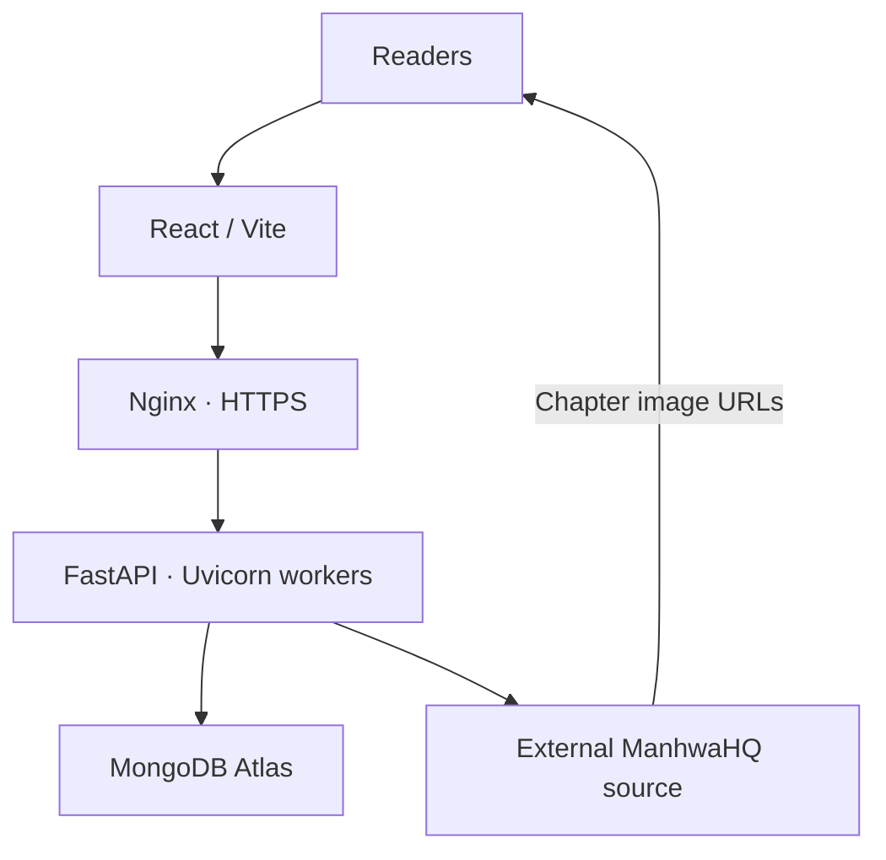

<div align="center">


# MANHWAVOID API

**THE ENGINE BEHIND YOUR NEXT CHAPTER.**


<br/>

[ FEATURES ](#-at-a-glance)　 [ QUICK START ](#-launch-in-minutes)　 [ API ](#-api-map)　 [ ROADMAP ](#-roadmap)

<br/>


### DISCOVER · READ · SAVE · RESUME

</div>

---

## ✦ At a glance

<div align="center">

| <b>CATALOGUE</b> | <b>READER</b> | <b>YOUR LIBRARY</b> |
|:---:|:---:|:---:|
|  |  |  |
| Search · Browse · Genres | Chapters · Reader data | Profiles · Bookmarks |
| Manga details · Updates | Recommendations | Reading history |

</div>

<div align="center">


</div>

> **Capacity goal:** 500–600 concurrent visitors. This is a target, not a verified capacity claim. Sustained load testing is still required.

## ✦ How it works



<sub>Chapter image URLs are returned to the browser. Image bytes are not intentionally proxied through this API.</sub>

## ✦ Feature cards

<table>
<tr>
<td width="50%" valign="top">

### 📚 Manga discovery
- Homepage and latest updates
- Browse and search
- Genre filtering
- Manga details
- Chapter lists
- Related recommendations

</td>
<td width="50%" valign="top">

### 📖 Reader
- Chapter metadata
- Page image URLs
- Reader navigation data
- External image loading
- Chapter progress tracking

</td>
</tr>
<tr>
<td width="50%" valign="top">

### 👤 Accounts
- Registration and login
- JWT access / refresh tokens
- User profiles and settings
- Avatar presets, URLs and uploads
- Account data export

</td>
<td width="50%" valign="top">

### 🔖 Personal library
- Bookmarks
- Reading history
- Last-read position
- Recent activity feed
- Persistent user preferences

</td>
</tr>
<tr>
<td width="50%" valign="top">

### ⚡ Performance
- Async HTTP client
- Bounded TTL cache
- Request coalescing
- Configurable source concurrency
- Connection pooling
- GZip compression

</td>
<td width="50%" valign="top">

### 🛡️ Reliability
- MongoDB-backed rate limits
- Upstream cooldown handling
- Retry backoff with jitter
- Configurable timeouts
- Multi-worker deployment
- 30-minute activity-log TTL

</td>
</tr>
</table>

## ✦ Stack

<div align="center">


<br/>


</div>

## ✦ Launch in minutes

### 1 · Requirements

`Python 3.10+`　`MongoDB Atlas`　`Git`

### 2 · Clone

```bash
git clone https://github.com/Akane-Ayato/Quanxi.git
cd ManhwaHQ-API
```

### 3 · Install

<details>
<summary><b>Windows · PowerShell</b></summary>

```powershell
python -m venv .venv
.\.venv\Scripts\Activate.ps1
python -m pip install --upgrade pip
pip install -r requirements.txt
Copy-Item .env.example .env
```

</details>

<details>
<summary><b>Linux · Ubuntu</b></summary>

```bash
python3 -m venv .venv
source .venv/bin/activate
python -m pip install --upgrade pip
pip install -r requirements.txt
cp .env.example .env
```

</details>

### 4 · Configure `.env`

```env
APP_NAME=ManhwaVoid API
APP_VERSION=0.6.0
ENVIRONMENT=production
API_PREFIX=/api/v1

MONGODB_URI=mongodb+srv://<username>:<password>@<cluster>/<database>
MONGODB_DATABASE=manhwavoid

JWT_SECRET=<your-unique-secret-at-least-32-characters>
JWT_ALGORITHM=HS256
CORS_ORIGINS=https://your-frontend-domain.example

RATE_LIMIT_ENABLED=true
RATE_LIMIT_FAIL_OPEN=false
```

Generate a secret:

```bash
python -c "import secrets; print(secrets.token_urlsafe(48))"
```

### 5 · Run

```bash
uvicorn app.main:app --host 127.0.0.1 --port 8000 --reload
```

<div align="center">

| HEALTH | DEVELOPER PORTAL |
|:---:|:---:|
| `/api/v1/health` | `/api-docs` |

</div>

## ✦ Worker deployment

<div align="center">

| 4 WORKERS | 8 WORKERS |
|:---:|:---:|
|  |  |

</div>

**Windows PowerShell · 4 workers**

```powershell
python -m uvicorn app.main:app --host 0.0.0.0 --port 8000 --workers 4
```

**Windows PowerShell · 8 workers**

```powershell
python -m uvicorn app.main:app --host 0.0.0.0 --port 8000 --workers 8
```

**Ubuntu / Linux**

```bash
WEB_CONCURRENCY=4 ./run.sh
```

Change to `8` only after comparing CPU, RAM, latency and MongoDB connection usage. `run.sh` is Bash; use WSL or Git Bash on Windows.

<details>
<summary><b>⚙️ Worker scaling: what multiplies?</b></summary>

Each worker has its own in-memory cache, HTTP client, source semaphore and MongoDB pool.

| Per-worker setting | Default | 4 workers | 8 workers |
|---|---:|---:|---:|
| Source concurrency | 3 | Up to 12 | Up to 24 |
| MongoDB max pool | 30 | Up to 120 | Up to 240 |
| Cache entries | 512 | 4 separate caches | 8 separate caches |

These are configuration-based upper bounds, not guaranteed active usage. Tune them for your VPS, Atlas tier and upstream source.

</details>

## ✦ API map

**Base path:** `/api/v1`

<details open>
<summary><b>🌐 Catalogue & reader</b></summary>

| Method | Route |
|:---:|:---|
| GET | `/home` |
| GET | `/browse` |
| GET | `/search` |
| GET | `/genres` |
| GET | `/genres/{genre}` |
| GET | `/manga/{slug}` |
| GET | `/manga/{slug}/chapters` |
| GET | `/manga/{slug}/recommendations` |
| GET | `/manga/{slug}/chapters/{chapter_number}` |

</details>

<details>
<summary><b>🔐 Authentication</b></summary>

| Method | Route |
|:---:|:---|
| POST | `/auth/register` |
| POST | `/auth/login` |
| POST | `/auth/refresh` |
| POST | `/auth/logout` |

</details>

<details>
<summary><b>👤 Profile & account</b></summary>

| Method | Route |
|:---:|:---|
| GET | `/users/avatars` |
| GET | `/users/{username}` |
| GET / PATCH | `/users/me` |
| GET | `/users/me/summary` |
| POST | `/users/me/username` |
| POST | `/users/me/email` |
| POST | `/users/me/password` |
| PUT | `/users/me/avatar/preset` |
| PUT | `/users/me/avatar/url` |
| POST | `/users/me/avatar/upload` |
| GET / PATCH | `/users/me/preferences` |
| GET | `/users/me/export` |

</details>

<details>
<summary><b>🔖 Bookmarks, history & activity</b></summary>

| Method | Route |
|:---:|:---|
| GET / POST | `/users/me/bookmarks` |
| DELETE | `/users/me/bookmarks/{manga_slug}` |
| GET / POST / DELETE | `/users/me/history` |
| GET | `/users/me/activity` |

</details>

Protected routes use:

```http
Authorization: Bearer <access_token>
```

## ✦ Data that expires

<div align="center">

# 30 MINUTES
### ACTIVITY LOG RETENTION


</div>

| Data | Automatic deletion |
|:---|:---:|
| Activity log entries | **30 minutes** |
| Reading history | No |
| Bookmarks | No |
| User accounts | No |
| Refresh sessions | At configured expiry |

MongoDB TTL cleanup runs asynchronously. Activity entries may remain slightly longer than 30 minutes. The TTL index is on `activity_logs.created_at`.

## ✦ Existing database migration


Back up MongoDB, configure the production environment, then run this once before starting the upgraded multi-worker API:

```bash
python -m scripts.migrate_reading_history
```

It keeps the newest record for each `(user_id, manga_slug)` pair, removes older duplicates in batches and ensures the unique compound index. Do not run it separately in every worker.

## ✦ Performance controls

| Setting | Default | Purpose |
|:---|---:|:---|
| `SOURCE_MAX_CONCURRENT` | `3` | Source requests per worker |
| `SOURCE_CONNECTION_LIMIT` | `20` | HTTPX connections per worker |
| `SOURCE_KEEPALIVE_LIMIT` | `10` | Keep-alive connections |
| `CACHE_TTL_SECONDS` | `180` | Cache lifetime |
| `CACHE_MAX_ITEMS` | `512` | Cache entries per worker |
| `CACHE_MAX_BYTES` | `67108864` | Approx. 64 MiB per-worker cache budget |
| `MONGODB_MAX_POOL_SIZE` | `30` | DB connections per worker |
| `MONGODB_MIN_POOL_SIZE` | `0` | Minimum DB connections per worker |
| `MONGODB_WAIT_QUEUE_TIMEOUT_MS` | `5000` | Pool wait timeout |
| `MONGODB_CONNECT_TIMEOUT_MS` | `5000` | Connect timeout |
| `MONGODB_SOCKET_TIMEOUT_MS` | `15000` | Socket timeout |
| `USER_ACTIVITY_TOUCH_INTERVAL_SECONDS` | `60` | Activity update throttle |
| `ACTIVITY_LOG_TTL_SECONDS` | `1800` | 30-minute activity expiry |
| `RATE_LIMIT_ENABLED` | `true` | Enable rate limiting |
| `RATE_LIMIT_FAIL_OPEN` | `true` code default | Set `false` for production |
| `WEB_CONCURRENCY` | `4` launcher | Uvicorn workers |
| `FORWARDED_ALLOW_IPS` | `127.0.0.1` launcher | Trusted proxy addresses |

See `.env.example` for the complete supported settings list.

## ✦ Roadmap

<div align="center">

### BUILD → OPTIMIZE → VERIFY → SCALE

</div>

<details open>
<summary><b>01 · Core platform — implemented</b></summary>

- [x] FastAPI foundation
- [x] Catalogue, search and genres
- [x] Manga details and reader metadata
- [x] Authentication and sessions
- [x] Profiles and avatars
- [x] Bookmarks and reading history

</details>

<details open>
<summary><b>02 · Performance work — implemented, full verification pending</b></summary>

- [x] MongoDB-backed rate limiting
- [x] Bounded cache and request coalescing
- [x] Configurable scraper concurrency
- [x] 30-minute activity-log retention
- [x] Multi-worker migration improvement
- [x] Reduced repeated activity writes

</details>

<details>
<summary><b>03 · Validation — next</b></summary>

- [ ] Full dependency-backed regression suite
- [ ] MongoDB Atlas integration test
- [ ] Compare 4 vs 8 workers
- [ ] Sustained 500-user test
- [ ] Peak 600-user test
- [ ] 750-user headroom test
- [ ] Production monitoring and tuning

</details>

<div align="center">

| TEST STAGE | USERS |
|:---|:---:|
| Baseline | `50 → 100` |
| Scale-up | `200 → 300` |
| Target | **`500 → 600`** |
| Headroom | `750` |

</div>

Measure p50/p95/p99 latency, requests per second, 429/5xx rates, CPU, RAM, MongoDB pool waits, cache hit rate and upstream errors. Use realistic think-time and mock/replay upstream responses for high-volume tests.

### Current verification status

| Check | v0.6.0 record |
|:---|:---:|
| Python compilation | ✅ Passed |
| Developer portal JS syntax | ✅ Passed |
| Parser / normalizer tests | ✅ Passed |
| Cache / coalescing / cooldown tests | ✅ Passed |
| Full API suite | ⚠️ Blocked: Motor / PyMongo unavailable in build environment |
| Live MongoDB integration | ⏳ Pending |
| 500–600 user load test | ⏳ Pending |

**The API is not yet certified for 600 concurrent users.** Complete the full test suite and sustained staging load test before making that claim.

## ✦ Project structure

<details>
<summary><b>📁 View source tree</b></summary>

```text
ManhwaHQ-API/
├── app/
│   ├── api/
│   ├── auth/
│   ├── core/
│   ├── models/
│   ├── scraper/
│   ├── services/
│   ├── static/
│   │   ├── avatars/
│   │   └── developer_docs/
│   ├── users/
│   └── main.py
├── scripts/
│   └── migrate_reading_history.py
├── tests/
├── uploads/
│   └── avatars/
├── .env.example
├── .gitignore
├── pyproject.toml
├── requirements.txt
├── requirements-browser.txt
├── run.sh
└── README.md
```

</details>

## ✦ Production checklist

- [ ] Keep `.env` out of Git.
- [ ] Rotate any previously exposed credentials.
- [ ] Use a unique JWT secret.
- [ ] Enforce HTTPS.
- [ ] Configure exact CORS origins.
- [ ] Trust forwarded IP headers only from your proxy.
- [ ] Restrict MongoDB network access.
- [ ] Back up before migrations.
- [ ] Monitor API and database errors.
- [ ] Respect the external source's terms and permissions.

---

<div align="center">

## ✦ BUILT FOR MANHWAVOID ✦


**Repository:** `Quanxi`

<a href="https://github.com/Akane-Ayato/Quanxi">
  
</a>

<br/><br/>


<br/><br/>


# MANHWAVOID
### READ · DISCOVER · CONTINUE

<sub>API v0.6.0 · FastAPI + MongoDB</sub>

</div>

---
